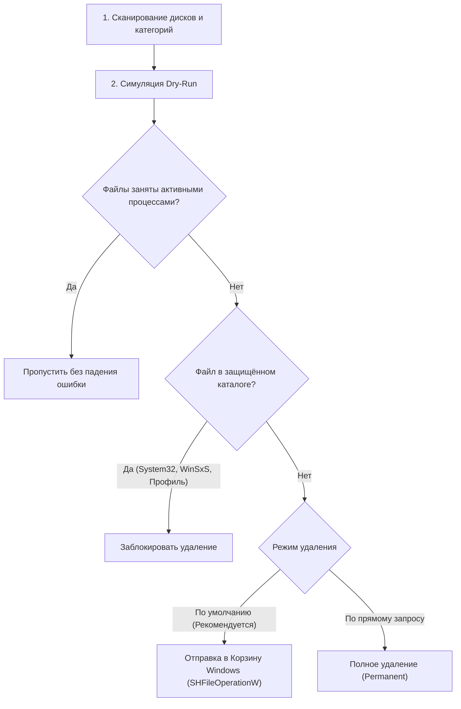

# 🧹 Antigravity Disk Cleaner

<div align="center">

[](LICENSE)
[](https://microsoft.com/windows)
[](https://python.org)
[](https://github.com/synchron1q/Antigravity-DiskCleaner)
[](mcp_config.json)

**Интеллектуальный помощник для глубокого анализа дискового пространства Windows, поиска системного и браузерного мусора, кэшей разработки, дубликатов по SHA-256 и безопасной очистки с интерактивным Generative UI дашбордом.**

[Ключевые возможности](#-ключевые-возможности) • [Результаты очистки](#-реальные-показатели-очистки-кейс) • [Архитектура безопасности](#-архитектура-безопасности-и-guardrails) • [Инструменты MCP](#-инструменты-mcp-сервера) • [Быстрый старт](#-быстрый-старт)

</div>

---

## 🎯 О проекте

**Antigravity Disk Cleaner** — это официальный плагин/скилл для **Google Antigravity**, разработанный для безопасного и прозрачного освобождения места на Windows-системах. Он совмещает мощное нативное ядро на Python (без тяжелых внешних pip-зависимостей, на чистом Win32 API), протокол **Model Context Protocol (MCP)** для бесшовного управления через ИИ-агентов и интерактивный **Generative UI дашборд** прямо внутри чата.

---

## 🏆 Реальные показатели очистки (Кейс)

В ходе боевого стресс-теста на системном диске **C:** плагин показал следующие результаты:

| Показатель | До очистки | После 1-го этапа | После 2-го этапа | Суммарно освобождено |
| :--- | :---: | :---: | :---: | :---: |
| **Свободное место на C:** | **22.70 ГБ** (10.2%) | **35.20 ГБ** (15.8%) | **41.88 ГБ** (18.8%) | **+19.18 ГБ** 🎉 |
| **Потенциал с UAC-скриптом** | — | — | **~48.70 ГБ** (21.9%) | **до +26.0 ГБ** |

### 🗂️ Детализация очищенных категорий

```text
[+19.18 ГБ] УСПЕШНО ОСВОБОЖДЕНО:
 ├── 12.40 ГБ — Системные кэши Windows (SoftwareDistribution, Windows Error Reporting, CrashDumps, TEMP)
 ├──  3.40 ГБ — Игровой мусор и кэши (BeamNG.drive моды, видеоповторы, кэш физики)
 ├──  1.90 ГБ — Клиент и кэш Steam (Program Files (x86)\Steam)
 ├──  0.70 ГБ — TLauncher & Minecraft (.minecraft, .tlauncher)
 ├──  0.35 ГБ — Пользовательские кэши AppData (AutoCAD, 1C, OBS Studio, Paint.NET)
 └──  0.23 ГБ — Кэш облачного хранилища Google Drive (DriveFS)

[ +6.88 ГБ] ГОТОВО К УДАЛЕНИЮ ЧЕРЕЗ UAC (Uninstall-ApprovedApps.bat):
 ├──  3.65 ГБ — Autodesk AutoCAD 2026 (Program Files + ProgramData)
 ├──  1.01 ГБ — 1C:Предприятие 8 (Тонкие клиенты x64 и x86)
 ├──  0.83 ГБ — Android SDK & OpenJDK
 ├──  0.61 ГБ — Paint.NET
 ├──  0.46 ГБ — OBS Studio
 └──  0.31 ГБ — Microsoft SQL Server LocalDB
```

---

## 🛡️ Архитектура безопасности и Guardrails

Безопасность пользовательских данных — главный приоритет плагина.



1. **Dry-Run First (Предпросмотр)**: Перед любой реальной очисткой формируется полная калькуляция объёмов и проверка занятости файлов процессами (заблокированные файлы браузеров или баз данных безопасно пропускаются).
2. **Корзина Windows по умолчанию (`SHFileOperationW`)**: Удаляемые файлы не затираются намертво, а перемещаются в Корзину Windows (`FOF_ALLOWUNDO`), откуда их можно восстановить за 1 клик.
3. **Белый список неприкосновенности (Zero False-Positive)**:
   - Среды разработки: **Visual Studio 2022**, **.NET SDK**, **VS Code**, **Google Antigravity**.
   - Офисные пакеты: **Microsoft Office**.
   - Пользовательские медиа: скриншоты (`Pictures\Screenshots`, Lightshot), рабочие архивы и проекты.
   - Защита системных директорий: жесткий запрет на операции в `System32`, `SysWOW64`, `WinSxS`.

---

## ⚡ Инструменты MCP-сервера

Плагин реализует официальный протокол **Model Context Protocol (JSON-RPC 2.0)** через `stdio`, что позволяет ИИ-агентам вызывать инструменты в нативном цикле рассуждений:

| Инструмент MCP | Описание | Параметры |
| :--- | :--- | :--- |
| `disk_overview_and_junk` | Сводка по всем дискам и быстрый аудит категорий мусора | `{}` |
| `analyze_disk_space` | Глубокий анализ: гигантские папки, топ файлов, забытые Downloads, дубликаты | `target_path`, `min_large_mb`, `old_days` |
| `clean_disk_junk` | Безопасная очистка категорий или путей в режимах Dry-Run/Recycle/Permanent | `target_ids`, `custom_paths`, `dry_run`, `mode` |
| `generate_disk_dashboard` | Генерация интерактивного HTML-дашборда и компактного виджета | `output_path`, `compact_path` |

---

## 📊 Интерактивный Generative UI

Плагин включает два уровня визуализации:
1. **Компактный виджет для чата (`ui/disk_cleaner_compact.html`)**: Встраивается прямо в сообщения агента через `<agent-embed>` с актуальными progress bar'ами и карточками свободного места.
2. **Полноэкранный автономный дашборд (`ui/disk_cleaner_dashboard.html`)**: С графиками заполненности, фильтрами категорий, интерактивными кнопками Dry-Run и отправки в Корзину в реальном времени.

---

## 🚀 Быстрый старт

### Вариант 1. Использование в Google Antigravity (Как плагин/скилл)

1. Клонируйте репозиторий в каталог плагинов Antigravity:
   ```powershell
   git clone https://github.com/synchron1q/Antigravity-DiskCleaner.git ~/.gemini/config/plugins/disk-cleaner
   ```
2. Активируйте скилл в диалоге с агентом:
   > *"Проанализируй диск C:, покажи дашборд с мусором и очисти кэш в режиме Dry-Run"*

### Вариант 2. Прямой запуск из командной строки (Standalone CLI)

```powershell
# 1. Сканирование и создание интерактивного дашборда
python skills/disk-cleaner/scripts/disk_cleaner_core.py --scan --html-out ui/dashboard.html

# 2. Безопасная очистка мусора в Корзину Windows
python skills/disk-cleaner/scripts/disk_cleaner_core.py --clean-ids "user_temp,chrome_cache,recycle_bin" --execute --mode recycle

# 3. Запуск веб-сервера локального дашборда
python skills/disk-cleaner/scripts/disk_cleaner_core.py --serve --port 8765
```

### Вариант 3. Запуск через готовые `.bat` скрипты

- `scripts/Start-DiskCleaner.bat` — моментальный запуск сканирования и открытие веб-дашборда в браузере.
- `scripts/Uninstall-ApprovedApps.bat` — полуавтоматический запуск деинсталляторов тяжелых программ с запросом UAC.

---

## 📁 Структура проекта

```text
Antigravity-DiskCleaner/
├── plugin.json                 # Манифест плагина Antigravity
├── mcp_config.json             # Конфигурация MCP-сервера
├── LICENSE                     # MIT Лицензия
├── README.md                   # Документация проекта
├── assets/
│   └── logo.svg                # Фирменный SVG-логотип
├── rules/
│   └── AGENTS.md               # Правила и защитные гардрейлы для ИИ-агентов
├── skills/
│   └── disk-cleaner/
│       ├── SKILL.md            # Инструкция и документация скилла
│       └── scripts/
│           ├── disk_cleaner_core.py  # Нативное ядро (Win32 API, сканер, клинер)
│           └── mcp_server.py         # Stdio MCP Server (JSON-RPC 2.0)
├── ui/
│   ├── disk_cleaner_dashboard.html  # Полноэкранный Generative UI дашборд
│   └── disk_cleaner_compact.html    # Компактный встраиваемый виджет
└── scripts/
    ├── Start-DiskCleaner.bat        # Запуск сканирования и веб-интерфейса
    └── Uninstall-ApprovedApps.bat   # Пакетное удаление одобренных программ (UAC)
```

---

## 👤 Автор

**Serikov Farhat Ibragymuly** ([@synchron1q](https://github.com/synchron1q))

---

## 📄 Лицензия

Проект распространяется под открытой лицензией [MIT](LICENSE).
